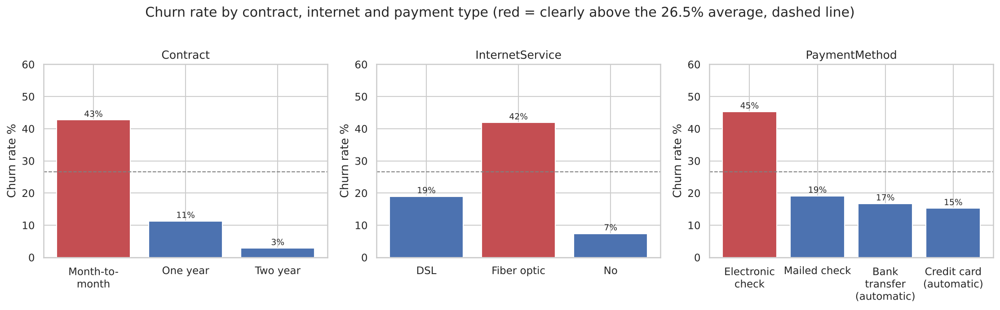
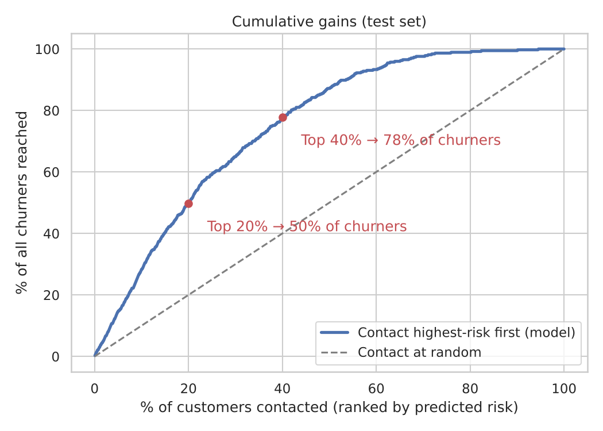
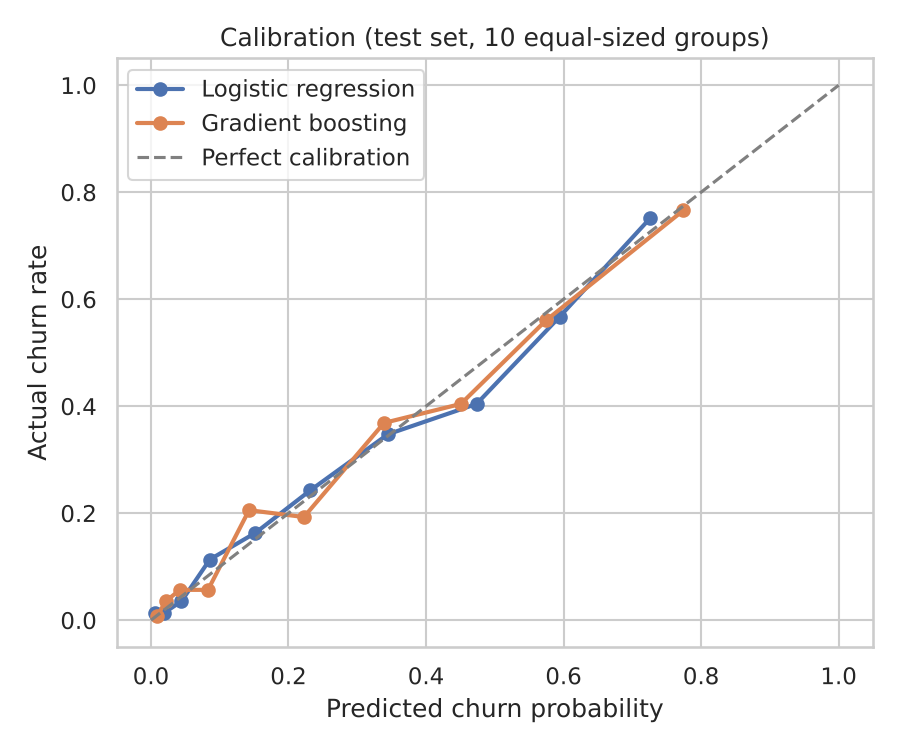
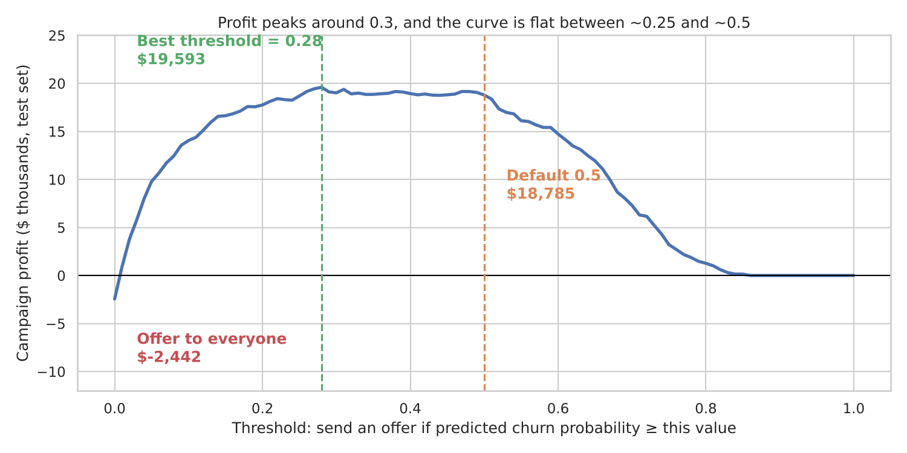
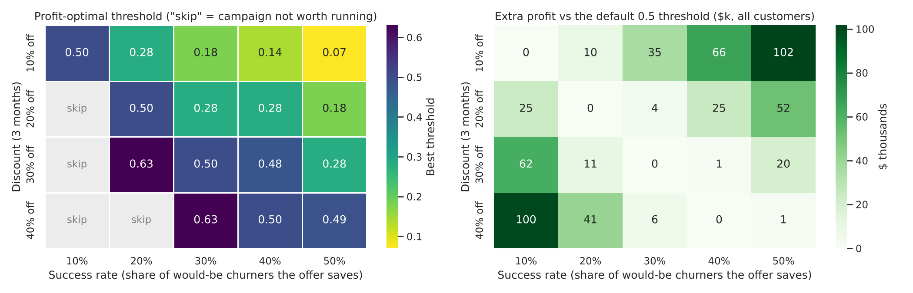

# Customer Churn Prediction & Retention ROI

**Who should a telecom company give a retention offer to, so that it makes money instead of losing it?**

This project predicts which customers are likely to leave, then turns those predictions into a **profit-maximising targeting decision**, including a sensitivity analysis showing how the right decision changes with the economics of the offer.

  

---

## Key findings

| | |
|---|---|
| 💸 **Offering a discount to everyone loses money** | **−$12k**: most customers would have stayed anyway |
| 🎯 **Model-based targeting turns it into a profit** | **+$98k**, contacting 40% of customers and reaching 78% of churners |
| ⚖️ **0.5 is not the right threshold** | Profit-optimal threshold ≈ **0.28**, matching the **0.31 break-even** derived from the economics |
| 🔁 **The best decision depends on the offer** | From "target broadly" (threshold 0.07) to "don't run the campaign at all", depending on discount size and success rate |
| 🧠 **Simple model, chosen on purpose** | Logistic regression matched random forest and gradient boosting (ROC-AUC ≈ 0.85), and it is explainable and well calibrated |

---

## Business problem

The company loses **26.5% of customers**, who were paying **$139k per month** (30.5% of monthly revenue).
Retention offers cost money, and every discount given to a customer who would have stayed anyway is wasted.
**Goal:** decide *which* customers should receive an offer to **maximise campaign profit**.

## Data

[IBM Telco Customer Churn](https://github.com/IBM/telco-customer-churn-on-icp4d) sample dataset: 7,043 customers of a fictional US telecom company with contract, service, billing and demographic information. `Churn = Yes` means the customer left.

## Approach

| Notebook | What it does |
|---|---|
| [`01_cleaning_and_eda`](notebooks/01_cleaning_and_eda.ipynb) | Fixes `TotalCharges` (blank for brand-new customers → 0, after investigating why), explores who churns and why |
| [`02_modelling`](notebooks/02_modelling.ipynb) | Leak-free pipeline, 5-fold CV comparison of logistic regression / random forest / gradient boosting, calibration, gains curve, odds ratios, permutation importance |
| [`03_decision_analysis`](notebooks/03_decision_analysis.ipynb) | Puts dollar values on outcomes, finds the profit-maximising targeting rule, sensitivity analysis over discount × success rate |

---

## 1. Who churns?

<p align="center"></p>

- **Month-to-month customers** are 55% of the base but **89% of churners**.
- **53% churn in the first 6 months**, vs under 10% after 4 years.
- Customers with **online security or tech support churn less than half as often** (15% vs 42%). That's a correlation worth testing with an A/B experiment.

## 2. Predicting churn

| Model (5-fold CV) | ROC-AUC | PR-AUC | Accuracy |
|---|---|---|---|
| Dummy baseline | 0.500 | 0.265 | **73.5%** ← "accurate" but useless |
| **Logistic regression** ✅ | **0.846** | 0.662 | 80.2% |
| Random forest | 0.845 | 0.658 | 80.3% |
| Gradient boosting | 0.848 | 0.668 | 80.5% |

The differences between models are smaller than the variation between folds, so I chose the **simplest, most explainable** model. On the untouched test set it scores **ROC-AUC 0.842**, and its probabilities are well calibrated.

<p align="center"> </p>

Contacting the **riskiest 20%** of customers reaches **50% of all churners** (random targeting: 20%).

## 3. From prediction to decision

**Assumptions:** offer = 20% off for 3 months + $5 contact cost · value of a saved customer = 12 months × bill × 60% margin · 30% of would-be churners are saved by the offer.

Expected profit of targeting customer *i* = *p<sub>i</sub>* × success rate × value<sub>i</sub> − cost<sub>i</sub>

<p align="center"></p>

| Strategy (scaled to all 7,043 customers) | Profit |
|---|---|
| Offer to everyone | −$12k |
| Model, default threshold 0.5 | $94k |
| **Model, profit-optimal threshold 0.28** | **$98k** |
| Model, individual expected-value rule | $96k |

The profit curve is flat between ~0.25 and ~0.5, so under these assumptions **the main gain comes from targeting instead of offering to everyone**.

### Sensitivity analysis: the right threshold depends on the offer

<p align="center"></p>

- **Cheap, effective offer** → target broadly (threshold 0.07, **+$102k** vs using 0.5).
- **Expensive offer that rarely works** → **don't run the campaign** ("skip"); using 0.5 there would lose up to $100k.
- The **success rate** changes the answer most, so it should be measured before scaling.

---

## Recommendations

1. **Don't send offers to everyone.** Target customers with predicted churn risk above ~0.3 (about 40% of the base).
2. **Run an A/B test** on the targeted group to measure the offer's real success rate, then set the threshold from the sensitivity table.
3. **Move month-to-month customers to annual contracts** and **push automatic payment**, the two strongest structural levers.
4. **Invest in the first 6 months** (onboarding), where over half of new customers are lost.
5. **Test bundling tech support / online security** as a retention offer.

## Limitations & next steps

- Customer value and offer success rate are **assumptions**. In practice they'd come from finance data and past campaigns.
- The model predicts **who will churn**, not **who can be persuaded**. Next step: **uplift modelling** trained on A/B test data.
- Profit is estimated on 1,409 test customers and scaled up, so it has uncertainty.

---

## How to run

```bash
git clone https://github.com/MOOZYYYY/churn-prediction.git
cd churn-prediction
pip install -r requirements.txt
curl -L -o data/telco_churn.csv https://raw.githubusercontent.com/IBM/telco-customer-churn-on-icp4d/master/data/Telco-Customer-Churn.csv
jupyter notebook notebooks/
```

Run the notebooks in order (01 → 02 → 03).

## Project structure

```
├── data/                  # raw + processed data (not tracked; see How to run)
├── notebooks/
│   ├── 01_cleaning_and_eda.ipynb
│   ├── 02_modelling.ipynb
│   └── 03_decision_analysis.ipynb
├── reports/figures/       # charts used in this README
└── requirements.txt
```
